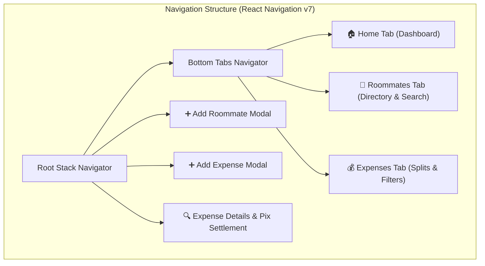

<div align="center">

# 📱 Pindura Mobile — Shared Expense Management on the Go

<p align="center">
  <strong>Cross-platform mobile application (Android & iOS) for seamless expense tracking and debt settlement in shared student housings. Official mobile port of the <a href="https://github.com/GuilhermeHenriqueNunes/Pindura">Pindura</a> ecosystem.</strong>
</p>

<p align="center">
  <a href="README.md">🇧🇷 Português</a> •
  <a href="README.en.md">🇺🇸 English</a>
</p>

[]()
[](https://reactnative.dev/)
[](https://expo.dev/)
[](https://reactnavigation.org/)
[](https://developer.mozilla.org/en-US/docs/Web/JavaScript)
[]()

</div>

---

## 📌 Executive Summary

**Pindura Mobile** is the mobile evolution of the web-based [Pindura](https://github.com/GuilhermeHenriqueNunes/Pindura) shared expense system. Designed to put financial clarity in the hands of roommates and student housemates, it enables instant expense recording at the point of purchase, quick checking of unsettled balances, and one-tap Pix key copying directly on mobile devices.

Developed collaboratively by a two-engineer team adopting modern patterns in the React Native (v0.88) and Expo (SDK 58) ecosystem.

---

## 🏗️ Architecture & Navigation Flow

The application leverages a hybrid navigation layout (Tabs + Modal Stacks) to deliver native feel, smooth transitions, and intuitive UX:



### 📁 Source Code Organization

```text
pindura-mobile/
├── assets/                  # App icons, splash screens, and favicons
├── src/
│   ├── components/          # Reusable atomic UI components (Cards, Buttons, Badges)
│   ├── navigation/          # Route setup (Stack and Bottom Tabs)
│   ├── screens/             # Screen components (Home, Roommates, Expenses)
│   └── services/            # API communication client
├── App.js                   # Application root with Theme and Navigation providers
├── app.json                 # Expo project manifest
└── package.json             # Manifest and run scripts
```

---

## 🗺️ Project Roadmap

- [x] **Project Setup**: Initialized with Expo SDK 58 and React Native 0.88.
- [x] **Navigation Foundation**: Configured `@react-navigation/native`, `bottom-tabs`, and `stack`.
- [x] **Specifications & Architecture**: Requirements mapped and layout standards defined.
- [ ] **UI & Screens**:
  - [ ] Dashboard Screen with expense KPIs and quick shortcuts.
  - [ ] Roommates Directory with real-time search.
  - [ ] Roommate Registration Form with Pix key validation.
  - [ ] Expenses Feed with payer visual badges.
  - [ ] Expense Creation Form with multi-participant selector.
  - [ ] Expense Details View with "Copy Pix Key" action.
- [ ] **API Integration**: REST client connecting to the [Pindura Backend](https://github.com/GuilhermeHenriqueNunes/Pindura).
- [ ] **Offline Cache**: Local persistence via AsyncStorage.

---

## 🚀 Quickstart Guide

### Prerequisites
- **Node.js** (v20+ LTS recommended).
- **Expo Go** mobile app on your smartphone ([Android](https://play.google.com/store/apps/details?id=host.exp.exponent) or [iOS](https://apps.apple.com/app/expo-go/id982107779)), or a configured local emulator (Android Studio / Xcode).

### Running the App

```bash
# 1. Clone the repository
git clone https://github.com/GuilhermeHenriqueNunes/Pindura-Mobile.git
cd Pindura-Mobile

# 2. Install dependencies
npm install

# 3. Start Expo development server
npx expo start
```

Once running:
- **On physical phone**: Open **Expo Go** and scan the terminal QR Code.
- **On Android Emulator**: Press `a` in the terminal.
- **On iOS Simulator (macOS)**: Press `i` in the terminal.
- **On Web Browser**: Press `w` in the terminal.

---

## 🔗 The Pindura Ecosystem

This app interacts with and complements:
- 🌐 **[Pindura Web / API](https://github.com/GuilhermeHenriqueNunes/Pindura)**: The core backend service built with Java 21, Spring Boot 3, and MySQL handling transaction rules and settlement math.

---

## 👥 Authors & Collaborators

Crafted in collaboration by:

<table align="center">
  <tr>
    <td align="center">
      <a href="https://github.com/GuilhermeHenriqueNunes">
        <br />
        <sub><b>Guilherme Nunes</b></sub>
      </a><br />
      <a href="https://www.linkedin.com/in/guilherme-henriquesilva-nunes/" title="LinkedIn">
        
      </a>
      <a href="https://github.com/GuilhermeHenriqueNunes" title="GitHub">
        
      </a>
    </td>
    <td align="center">
      <a href="https://github.com/cordeiromarcos">
        <br />
        <sub><b>Marcos Cordeiro</b></sub>
      </a><br />
      <a href="https://github.com/cordeiromarcos" title="GitHub">
        
      </a>
    </td>
  </tr>
</table>

---

## 📄 License

This open-source educational project is licensed under the [MIT License](LICENSE).
