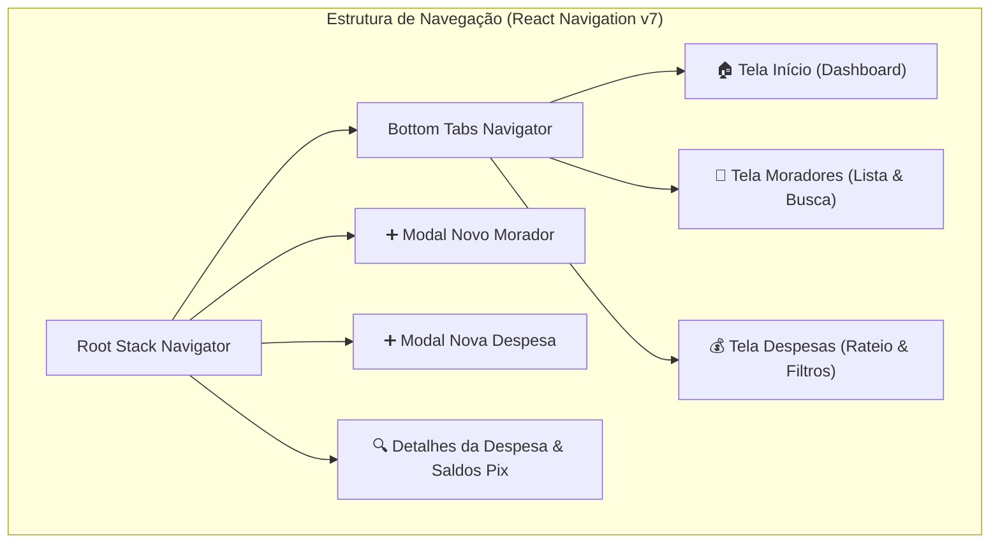

<div align="center">

# 📱 Pindura Mobile — Gestão Compartilhada no seu Bolso

<p align="center">
  <strong>Aplicativo mobile cross-platform (Android & iOS) para gerenciamento e rateio de despesas em moradias compartilhadas. Port oficial do ecossistema <a href="https://github.com/GuilhermeHenriqueNunes/Pindura">Pindura</a>.</strong>
</p>

<p align="center">
  <a href="README.md">🇧🇷 Português</a> •
  <a href="README.en.md">🇺🇸 English</a>
</p>

[]()
[](https://reactnative.dev/)
[](https://expo.dev/)
[](https://reactnavigation.org/)
[](https://developer.mozilla.org/en-US/docs/Web/JavaScript)
[]()

</div>

---

## 📌 Sobre o Projeto

O **Pindura Mobile** é a evolução para dispositivos móveis do sistema web [Pindura](https://github.com/GuilhermeHenriqueNunes/Pindura). O objetivo é levar para a ponta dos dedos dos moradores de repúblicas estudantis e residências compartilhadas a facilidade de registrar notas, consultar saldos devidos e copiar chaves Pix diretamente pelo smartphone no exato momento da compra.

O projeto está sendo construído em conjunto por uma dupla de desenvolvedores, adotando as práticas mais recentes do ecossistema React Native (versão 0.88) e Expo (SDK 58).

---

## 🏗️ Arquitetura e Fluxo de Navegação

A aplicação adota um padrão de navegação híbrido (Tabs + Stacks) para garantir ergonomia nativa e transições fluidas:



### 📁 Estrutura do Código-Fonte

```text
pindura-mobile/
├── assets/                  # Ícones nativos, splash screen e favicon
├── src/
│   ├── components/          # Componentes reutilizáveis (Cards, Botões, Badges)
│   ├── navigation/          # Configuração de rotas (Stack e Bottom Tabs)
│   ├── screens/             # Telas da aplicação (Home, Moradores, Despesas)
│   └── services/            # Camada de comunicação com a API REST
├── App.js                   # Ponto de entrada com Providers de Tema e Navegação
├── app.json                 # Configurações do ecossistema Expo
└── package.json             # Dependências e scripts de execução
```

---

## 🗺️ Roadmap de Desenvolvimento

- [x] **Setup do Projeto**: Inicialização com Expo SDK 58 e React Native 0.88.
- [x] **Fundação de Navegação**: Instalação e configuração de `@react-navigation/native`, `bottom-tabs` e `stack`.
- [x] **Documentação & Requisitos**: Mapeamento de guias e padrões de interface.
- [ ] **Interface & Telas**:
  - [ ] Tela Inicial com KPIs de despesas e atalhos rápidos.
  - [ ] Listagem de Moradores com busca por nome.
  - [ ] Formulário de Cadastro/Edição de Moradores com validação de Chave Pix.
  - [ ] Listagem de Despesas com indicativo visual de pagador.
  - [ ] Formulário de Despesa com multi-seleção de participantes.
  - [ ] Tela de Detalhamento com botão de "Copiar Chave Pix".
- [ ] **Camada de Integração**: Conexão com a API REST do [Pindura Backend](https://github.com/GuilhermeHenriqueNunes/Pindura).
- [ ] **Offline & Persistência Local**: Suporte a cache offline via AsyncStorage.

---

## 🚀 Como Executar Localmente

### Pré-requisitos
- **Node.js** (versão 20+ recomendada).
- Aplicativo **Expo Go** instalado no seu celular ([Android](https://play.google.com/store/apps/details?id=host.exp.exponent) ou [iOS](https://apps.apple.com/app/expo-go/id982107779)), ou emulador configurado (Android Studio / Xcode).

### Passo a Passo

```bash
# 1. Clone o repositório
git clone https://github.com/GuilhermeHenriqueNunes/Pindura-Mobile.git
cd Pindura-Mobile

# 2. Instale as dependências
npm install

# 3. Inicie o servidor do Expo
npx expo start
```

Após iniciar:
- **No celular físico**: Abra o app **Expo Go** e escaneie o QR Code exibido no terminal.
- **No Android Emulator**: Pressione a tecla `a` no terminal.
- **No iOS Simulator (macOS)**: Pressione a tecla `i` no terminal.
- **No Navegador Web**: Pressione a tecla `w` no terminal.

---

## 🔗 Ecossistema Pindura

Este aplicativo consome e complementa o ecossistema Pindura:
- 🌐 **[Pindura Web / API](https://github.com/GuilhermeHenriqueNunes/Pindura)**: Aplicação web construída em Java 21, Spring Boot 3 e MySQL responsável pela persistência e regras de rateio.

---

## 👥 Autores & Colaboradores

Projeto desenvolvido em colaboração por:

<table align="center">
  <tr>
    <td align="center">
      <a href="https://github.com/GuilhermeHenriqueNunes">
        <br />
        <sub><b>Guilherme Nunes</b></sub>
      </a><br />
      <a href="https://www.linkedin.com/in/guilherme-henriquesilva-nunes/" title="LinkedIn">
        
      </a>
      <a href="https://github.com/GuilhermeHenriqueNunes" title="GitHub">
        
      </a>
    </td>
    <td align="center">
      <a href="https://github.com/cordeiromarcos">
        <br />
        <sub><b>Marcos Cordeiro</b></sub>
      </a><br />
      <a href="https://github.com/cordeiromarcos" title="GitHub">
        
      </a>
    </td>
  </tr>
</table>

---

## 📄 Licença

Este projeto é desenvolvido para fins acadêmicos e open-source sob a licença [MIT](LICENSE).
